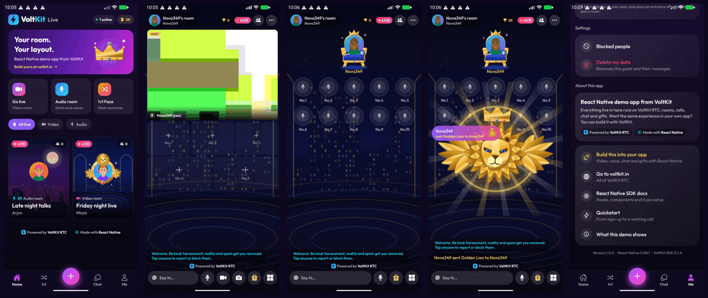

# VoltKit RTC: React Native example

A complete live social app built on [VoltKit RTC](https://voltkit.in/rtc/react-native), written to be read. It has video rooms,
audio rooms with seats, random 1v1 video calls, room chat, direct messages, moderation and SVGA gifts, all on
`@voltkit-rtc/react-native`.

Use it two ways: run it to see what VoltKit does, or open the file for the feature you need and copy the approach into your own app.



## Start here

| I want to... | Read |
| --- | --- |
| Run this app | [Run it](#run-it), below |
| Add VoltKit to my own React Native app | [Integrate VoltKit into your app](docs/integrate-into-your-app.md) |
| Understand how the pieces fit | [Architecture](docs/architecture.md) |
| Build hosts, co-hosts, moderators and seats | [Rooms, roles and seats](docs/rooms-roles-seats.md) |
| Build 1v1 calls | [One-to-one calls](docs/one-to-one-calls.md) |
| Build chat, gifts and SVGA animations | [Chat and gifts](docs/chat-and-gifts.md) |
| Ship a release build | [Going to production](docs/going-to-production.md) |
| Fix something that does not work | [Good to know](docs/good-to-know.md) |

The app needs a backend to hand out tokens. Its code and guide are in
[voltkit-rtc-backend-demo](https://github.com/voltkit-rtc/voltkit-rtc-backend-demo).

## Where each feature lives

| Feature | Code | VoltKit APIs it shows |
| --- | --- | --- |
| Joining and leaving a room | [`src/screens/RoomScreen.tsx`](src/screens/RoomScreen.tsx) | `VoltkitProvider`, `useRoom`, `onClosed`, `tokenExpiring` |
| Everything a room does | [`src/rtc/useRoomEngine.ts`](src/rtc/useRoomEngine.ts) | `useLocalMedia`, `useParticipants`, `useRemoteTracks`, `useVoltkitEvent` |
| Video cards | [`src/components/room/stage-video.tsx`](src/components/room/stage-video.tsx) | `VideoTrack`, `useIsSpeaking`, `useStreamFallback` |
| Audio seats | [`src/components/room/stage-audio.tsx`](src/components/room/stage-audio.tsx) | `useIsSpeaking` |
| Seats | [`src/rtc/seats.ts`](src/rtc/seats.ts) | `claim`, `release`, `blockSlot`, `claimChanged` |
| Who may do what | [`src/rtc/permissions.ts`](src/rtc/permissions.ts) | The four roles |
| Moderation | [`src/components/room/sheets.tsx`](src/components/room/sheets.tsx) | `forceMute`, `kick`, `promote`, `muteChat`, `deleteMessage` |
| Permissions and consent | [`src/rtc/consent.tsx`](src/rtc/consent.tsx) | `requestMediaPermissions` |
| Error messages | [`src/rtc/errors.ts`](src/rtc/errors.ts) | `RpcError`, `isTerminalError` |
| 1v1 calls | [`src/screens/MatchScreen.tsx`](src/screens/MatchScreen.tsx) | A room per call, `participantLeft` |
| Room chat and hearts | [`src/components/room/chat.tsx`](src/components/room/chat.tsx), [`reactions.tsx`](src/components/room/reactions.tsx) | `sendMessage`, `getMessages`, ephemeral messages |
| Lounge and direct messages | [`src/screens/ChatScreens.tsx`](src/screens/ChatScreens.tsx) | `ChatClient` |
| SVGA gifts and entrance effects | [`src/gifts/`](src/gifts/) | Gift events through chat |

## Run it

You need Node 20 or newer, a JDK (17 or 21), the Android SDK, and a [free VoltKit account](https://voltkit.in/rtc).
An Android phone is best: the emulator's microphone is silent and its cameras are simulated.

**1. Start the backend.** Follow the [backend's README](https://github.com/voltkit-rtc/voltkit-rtc-backend-demo#run-it). It runs on port 4000
with your own VoltKit keys.

**2. Install the app's dependencies.**

```bash
git clone https://github.com/voltkit-rtc/react-native-example-audio-video.git
cd react-native-example-audio-video
npm install
cp .env.example .env
```

**3. Point the app at your backend.** Edit `EXPO_PUBLIC_API_URL` in `.env`:

| Running on | Value |
| --- | --- |
| Android emulator | `http://10.0.2.2:4000` (the default) |
| A phone on your Wi-Fi | `http://192.168.1.20:4000`, using your computer's address |

**4. Build and run.**

```bash
npx expo run:android
```

This is a [development build](https://voltkit.in/docs/react-native-expo), not Expo Go. VoltKit needs native code that Expo Go cannot load.

**5. Try it with two devices.** Go live on one and join from the other. Tap an empty seat to ask for it, and accept from the
host's People list. Then open a card to see the host's powers.

To check your setup without a device:

```bash
npm run typecheck
npm test
```

## Project layout

```text
index.ts              Entry point. Loads the VoltKit SDK first
app.config.js         App name, permissions and the VoltKit Expo plugin
plugins/              Config plugins: release signing, http for local backends
src/
  rtc/                The VoltKit layer. Start reading here
  screens/            One file per screen
  components/room/    Video cards, audio seats, chat, hearts and sheets
  gifts/              SVGA playback, queue and the gift sheet
  api/                REST and Socket.IO clients for the backend
  state/              The guest session
docs/                 The guides linked above
```

`src/rtc/` holds most of the VoltKit logic, and its pure parts ([`seats.ts`](src/rtc/seats.ts), [`permissions.ts`](src/rtc/permissions.ts),
[`layout.ts`](src/rtc/layout.ts)) have no dependencies, so you can lift them straight into your app.

## Tested with

| | Version |
| --- | --- |
| `@voltkit-rtc/react-native`, `@voltkit-rtc/react` | 0.1.4 |
| `@voltkit-rtc/client` | 0.9.16 |
| `react-native-webrtc` | 155.0.1 |
| React Native | 0.88.1, New Architecture, Hermes |
| Expo | SDK 58 |
| `@dasimems/react-native-svga` | 0.1.4 |

Run on a POCO X3 Pro (Android 12, MIUI 13) and the Android emulator (API 37.1). iOS has not been built or tested: the VoltKit React Native
SDK is in preview there.

## More

- [React Native SDK guide](https://voltkit.in/docs/react-native-sdk) and [reference](https://voltkit.in/docs/react-native-sdk-reference)
- [All VoltKit docs](https://voltkit.in/docs)
- [Backend for this app](https://github.com/voltkit-rtc/voltkit-rtc-backend-demo)

## Licence

MIT, see [LICENSE](LICENSE). The VoltKit name and logo are not part of that licence: replace them in your own app.
