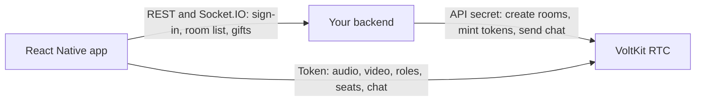
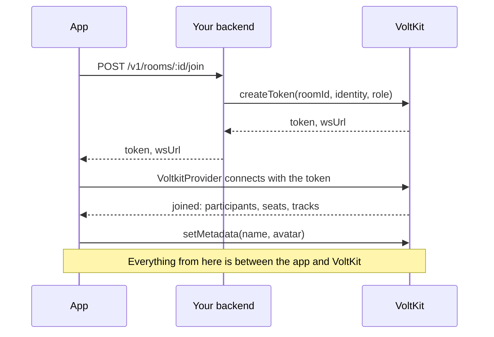
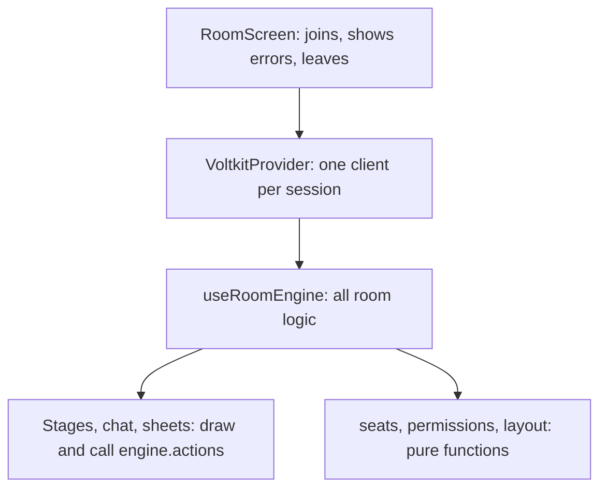

# Architecture

How the app, your backend and VoltKit fit together, and why the code is split the way it is.

## Three parties

The app talks to VoltKit directly for everything live. Audio and video never pass through your backend, so the backend stays small and cheap
however many people are in a room.

| Party | Owns | Never does |
| --- | --- | --- |
| **Your backend** | Who someone is, what room they may join, and in what role. Anything worth money, such as gifts | Touch media |
| **VoltKit** | Rooms, media, roles, seats, chat. It enforces every permission | Know your users beyond the identity you give it |
| **The app** | Showing all of that, and asking for changes | Hold the API secret, or decide a permission |

> [!IMPORTANT]
> The app never holds your VoltKit API secret. Anyone with the secret can create rooms and spend your minutes, and an app binary can be
> unpacked. The app only ever receives short-lived tokens.

## Joining a room

**Why the role comes from the backend:** the role is signed into the token, so a modified app cannot make itself a host. After that, roles
change live on VoltKit: when a host promotes someone, the service checks the new role on every action, and no new token is needed.

## Who holds which state

Each piece of state has one owner. The app never keeps a second copy that could disagree.

| State | Owner | How the app reads it |
| --- | --- | --- |
| Who is in the room, and their roles | VoltKit | `useParticipants()` |
| Tracks being received | VoltKit | `useRemoteTracks()` |
| Your own camera and microphone | VoltKit SDK | `useLocalMedia()` |
| Seats | VoltKit | `client.info.claims` to start, then `claimChanged` |
| Room settings: layout, seat mode | VoltKit | `client.info.metadata`, then `roomMetadataChanged` |
| Room list, gift catalog, coins, blocks | Your backend | REST |
| The 1v1 waiting line | Your backend | Socket.IO |

**Why seats and settings live on VoltKit and not your database:** they change while people are in the room, and everyone must see the same
thing at once. VoltKit already has a connection to each person, and it settles two people tapping the same seat.

## How the code is arranged

- [`RoomScreen`](../src/screens/RoomScreen.tsx) owns the session: fetching a token, mounting the provider, and what to show when it ends.
- [`useRoomEngine`](../src/rtc/useRoomEngine.ts) holds what a room does. It returns state and an `actions` object, so components stay simple.
- Components draw state and call actions. None of them calls the SDK for a room action directly.
- [`seats.ts`](../src/rtc/seats.ts), [`permissions.ts`](../src/rtc/permissions.ts) and [`layout.ts`](../src/rtc/layout.ts) are plain functions with
  unit tests, because the rules in them are the easiest to get subtly wrong.

## Design decisions

### A new provider for each session

`VoltkitProvider` gets `key={attempt}`, and joining again bumps it.

**Why:** a closed session stays closed. The SDK will not reconnect a client that has ended, so rejoining needs a new client, and a new `key` is
how React makes one.

### Separate "want" from "is"

The engine keeps `wantOnAir`, a ref saying this person means to be publishing, apart from `local.publishing`, which says whether they are.

**Why:** the two differ for moments that matter. After a promotion, the role changes first and the SDK may reconnect to another media server.
One effect compares the two and publishes when connected, so the result is the same whichever order those events arrive in.

### Refs for values read in event handlers

`claimsRef`, `participantsRef` and similar always hold the latest value.

**Why:** two events can arrive between renders. If `claimChanged` read the last rendered state, a second seat change in the same tick would
overwrite the first.

### Socket.IO beside VoltKit

The backend runs its own small Socket.IO server, used for the 1v1 waiting line, room list updates and inbox notices.

**Why:** those happen when someone is not in any room, so there is no VoltKit connection to carry them. Anything inside a room uses VoltKit.

### Gifts go through the backend

Clients ask the backend to send a gift. The backend takes the coins, then posts the gift into the room's chat itself.

**Why:** a message sent by a client could claim anything. A message sent by your backend can be trusted, which suits anything of value. See
[Chat and gifts](chat-and-gifts.md).
