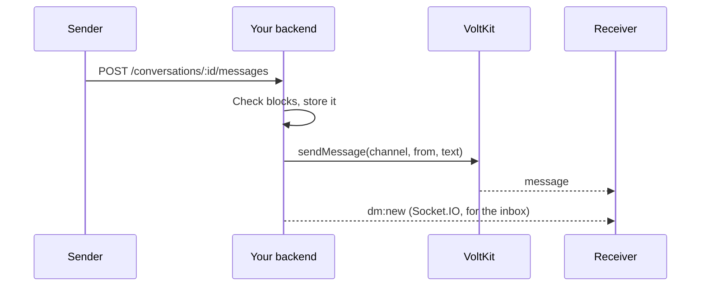
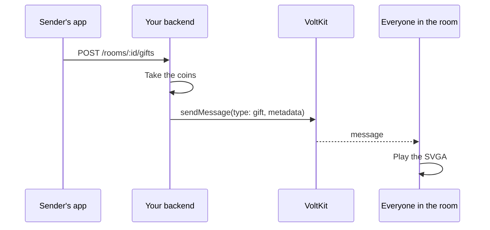

# Chat and gifts

This app has three kinds of chat, plus gifts and entrance effects, all carried by VoltKit chat.

| What | Connection | Code |
| --- | --- | --- |
| Room chat, hearts, gifts | The room's own connection | [`chat.tsx`](../src/components/room/chat.tsx), [`reactions.tsx`](../src/components/room/reactions.tsx) |
| Public Lounge | A chat-only connection | [`ChatScreens.tsx`](../src/screens/ChatScreens.tsx) |
| Direct messages | A chat-only connection, plus your backend | [`ChatScreens.tsx`](../src/screens/ChatScreens.tsx) |

## Room chat

Every room has chat from the moment it exists, on the connection you already hold. There is no second token. Listen with `useVoltkitEvent`, and send
with the client.

```tsx
import type { ChatMessage } from '@voltkit-rtc/client';
import { useVoltkitClient, useVoltkitEvent } from '@voltkit-rtc/react-native';
import { useState } from 'react';

export function useRoomMessages(me: { name: string; avatar: string }) {
  const client = useVoltkitClient();
  const [messages, setMessages] = useState<ChatMessage[]>([]);

  useVoltkitEvent('message', (m) => setMessages((list) => [...list, m])); // your own come back too
  useVoltkitEvent('messageDeleted', ({ id }) => setMessages((list) => list.filter((m) => m.id !== id)));

  const send = (text: string) => client?.sendMessage(text, { metadata: { name: me.name, avatar: me.avatar } });
  return { messages, send };
}
```

**Why the name travels with each message:** someone who wrote an hour ago may have left, so the roster cannot tell you who they were. A message that
carries its own name always shows correctly, in history too.

**Why not show your message before it comes back:** in a live room the echo is fast, and using one path keeps the list in the service's order.

Load earlier messages with `client.getMessages({ limit: 30 })`, oldest first. History is cleared when the room closes: this is live chat, not an archive.

> [!WARNING]
> `text` is delivered exactly as sent. Show it in a `Text`, and never treat it as markup.

### Hearts and reactions

```ts
import type { StreamClient } from '@voltkit-rtc/client';
declare const client: StreamClient;

await client.sendMessage('', { type: 'reaction', metadata: { emoji: 'heart' }, ephemeral: true });
```

**Why `ephemeral`:** it is delivered and then forgotten. Nobody who joins later needs to replay a thousand hearts.

`type` is yours to define. This app uses `gift`, `entrance`, `invite` and `reaction`.

### Moderating chat

| Action | Call | Who |
| --- | --- | --- |
| Mute someone | `client.muteChat(id, true)` | Hosts and moderators |
| Delete any message | `client.deleteMessage(id)` | Hosts and moderators |
| Delete your own | `client.deleteMessage(id)` | Anyone |

A mute belongs to the channel, so reconnecting does not undo it. A muted person can still read, and sending rejects with `chat-muted`.

## The Lounge: chat with no room

`ChatClient` opens a connection that carries chat only. Your backend mints a chat token, which is different from a room token.

```ts
import { ChatClient } from '@voltkit-rtc/client';
import '@voltkit-rtc/react-native';

export async function openLounge(wsUrl: string, token: string, onMessage: (text: string) => void) {
  const chat = new ChatClient(wsUrl, token);
  chat.on('message', (m) => onMessage(m.text ?? ''));
  const { messages } = await chat.connect(); // recent history comes with the join
  return { chat, messages };
}
```

Call `chat.close()` when the screen goes. **Why not a room:** people reading along need no media, and a chat-only connection uses none.

## Direct messages

The app sends through your backend, and receives through VoltKit.



**Why not send directly from the app:** chat history in VoltKit is live and short, while a conversation should last. A block also has to be checked
somewhere the sender cannot change. The backend does both.

Each conversation is its own VoltKit channel, and the backend only gives its chat token to the two people in it.

## Gifts

### How a gift travels



**Why through the backend:** the sender's app could claim any gift at any price. A message from your backend is trusted, and it skips client rate limits.
VoltKit has no gift API of its own: a gift is simply a chat message your app understands.

Coins in this app are demo coins with no value. If you add real money, the same design applies, and gifts must be settled on the server.

### Playing SVGA

[`GiftStage`](../src/gifts/GiftStage.tsx) listens for gift messages and plays them over the room, using
[`@dasimems/react-native-svga`](https://www.npmjs.com/package/@dasimems/react-native-svga), which needs `react-native-nitro-modules`. Both are
native, so build again after installing them.

```tsx
import { SvgaPlayer } from '@dasimems/react-native-svga';

export function OneGift({ url, onDone }: { url: string; onDone: () => void }) {
  return <SvgaPlayer source={url} loops={1} style={{ width: '100%', aspectRatio: 1 }} onFinish={onDone} onError={onDone} />;
}
```

A real room needs more than playing a file, and each part below exists because of something that goes wrong:

| Problem | What this app does | Where |
| --- | --- | --- |
| The first gift waits on a download | Preloads the catalog on entering a room with `SvgaCache.preload` | `preloadGifts` |
| Ten gifts arrive at once | Plays them one at a time from a queue | [`queue.ts`](../src/gifts/queue.ts) |
| A busy room builds up a huge backlog | Caps the queue at 24, dropping the cheapest first | [`queue.ts`](../src/gifts/queue.ts) |
| The same message arrives twice | Ignores repeated ids | [`queue.ts`](../src/gifts/queue.ts) |
| A file is bad or cannot download | Falls back to the gift's still icon | `Fallback` |
| A player never reports finishing | A 9-second watchdog moves on | `GiftStage` |
| The app was in the background | Clears the queue: old gifts are not worth replaying | `GiftStage` |

### Use your own animations

Gift files are served by the backend, and each gift's `svgaUrl` in the `gifts` collection says where to find it. It can be a path or a full URL, so you can
change art without an app update. To make your own, [SVGA Maker](https://voltkit.in/tools/svga-maker) converts a video or GIF, and
[VoltKit's gift library](https://voltkit.in/rtc/free-gifts) has ready-made art.

### Entrance effects

A guest wearing an avatar frame arrives with an animation. The backend sends an `entrance` message when they join, as an ephemeral message, and
the same `GiftStage` plays it. **Why from the backend:** an effect that shows status should not be something a client can fake.
