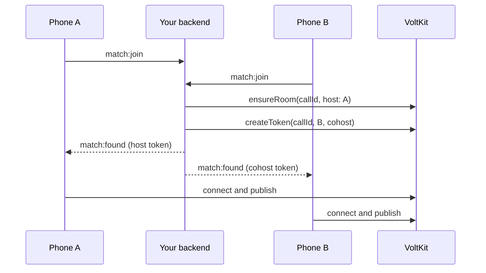

# One-to-one calls

The 1v1 screen matches two strangers for a video call. The same approach works for calling a friend: only how the two people are found changes.
The code is in [`MatchScreen.tsx`](../src/screens/MatchScreen.tsx).

## A call is a room with two people

There is no separate call API. One person is `host` and the other `cohost`, so both can publish.



**Why Socket.IO for the waiting line:** nobody is in a room yet, so there is no VoltKit connection to carry it. For calling a friend, your push
notifications do this job: send the call id to the other phone, and let it fetch a token.

## Connecting

```tsx
import { VoltkitProvider, type ClosedReason } from '@voltkit-rtc/react-native';
import type { ReactNode } from 'react';

const service = { title: 'Video call', text: 'Tap to return to the call', leaveLabel: 'End call' };

export function Call(props: { call: { callId: string; wsUrl: string; token: string }; onGone: () => void; children: ReactNode }) {
  const { call } = props;
  return (
    <VoltkitProvider
      key={call.callId}
      wsUrl={call.wsUrl}
      token={call.token}
      callService={service}
      onClosed={(reason: ClosedReason) => {
        if (reason !== 'left') props.onGone();
      }}
    >
      {props.children}
    </VoltkitProvider>
  );
}
```

**Why `key={call.callId}`:** Next moves straight to another call. A new key gives it a new client, and the old one closes cleanly.

For a voice call held to the ear, add `audio={{ speakerphone: false }}` and publish with `{ video: false }`.

## Your own picture on top

```tsx
import { VideoTrack, useLocalMedia, useRemoteTracks } from '@voltkit-rtc/react-native';
import { StyleSheet, View } from 'react-native';

export function CallVideo() {
  const local = useLocalMedia();
  const remote = useRemoteTracks({ kind: 'video', source: 'camera' }).find((video) => !video.paused);
  const camera = local.camEnabled ? local.stream?.getVideoTracks()[0] : undefined;

  return (
    <View style={StyleSheet.absoluteFill}>
      {remote && <VideoTrack track={remote.track} producerId={remote.producerId} objectFit="cover" style={StyleSheet.absoluteFill} />}
      {camera && (
        <View style={styles.preview}>
          <VideoTrack track={camera} mirror={local.facingMode === 'user'} zOrder={1} style={StyleSheet.absoluteFill} />
        </View>
      )}
    </View>
  );
}

const styles = StyleSheet.create({
  preview: { position: 'absolute', top: 60, right: 12, width: 104, height: 150, borderRadius: 10, overflow: 'hidden' },
});
```

**Why `zOrder={1}`:** two video views can overlap, and Android needs to be told which is on top.

## Telling "they left" from "they dropped"

`participantLeft` carries a reason, and it decides what to do.

| Reason | Meaning | What this app does |
| --- | --- | --- |
| `left` | They hung up | Ends the call |
| `disconnected` | Their connection dropped, or it is moving | Waits 30 seconds |
| `presence-lost` | The service lost track of them | Waits 30 seconds |

```tsx
import { useVoltkitEvent } from '@voltkit-rtc/react-native';
import { useRef } from 'react';

const PEER_AWAY_MS = 30_000;

export function useCallEnd(peerId: string, onPeerLeft: () => void) {
  const away = useRef<ReturnType<typeof setTimeout> | null>(null);
  const clearAway = () => {
    if (away.current) clearTimeout(away.current);
    away.current = null;
  };

  useVoltkitEvent('participantLeft', ({ identity, reason }) => {
    if (identity !== peerId) return;
    if (reason === 'disconnected' || reason === 'presence-lost') {
      clearAway();
      away.current = setTimeout(onPeerLeft, PEER_AWAY_MS);
    } else {
      onPeerLeft();
    }
  });
  useVoltkitEvent('participantJoined', ({ identity }) => {
    if (identity === peerId) clearAway();
  });
}
```

**Why wait:** switching from Wi-Fi to mobile data looks like a drop, and the SDK reconnects in seconds. Ending at once would cut calls that were about
to recover. **Why stop waiting:** a phone that crashed never comes back, and the other person should not sit looking at nothing.

In testing, a call survived Wi-Fi being switched off for 8 seconds: the phone moved to mobile data and the picture came back.

## Hanging up

Either side tells the backend, which closes the VoltKit room and tells the other side.

| Step | Where |
| --- | --- |
| `match:end` with the call id | The app, over Socket.IO |
| `deleteRoom(callId)` | The backend |
| `match:ended` | Sent to the other person |

**Why the backend closes the room:** otherwise a room would stay open until VoltKit's idle timer ran out, and a call that looks over could keep
counting.

## Safety

Calls with strangers need a way out. The shield button in a call offers Report and Block, and the backend will not match two people when either has
blocked the other. The backend also remembers each person's last match, so Next does not return the same stranger when others are waiting.
