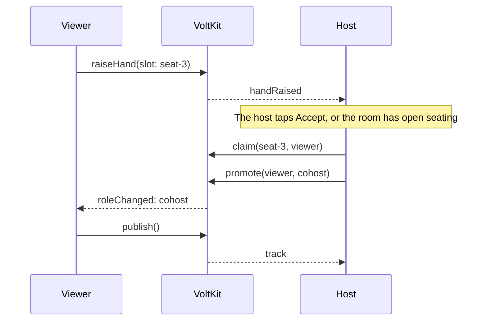

# Rooms, roles and seats

How video rooms and audio rooms work: who can do what, how someone gets on stage, and how moderation works. All of it is in
[`useRoomEngine.ts`](../src/rtc/useRoomEngine.ts).

## Two kinds of room, one engine

| | Video room | Audio room |
| --- | --- | --- |
| Publishing | Camera and microphone | Microphone only |
| Layout | Cards in a stage or grid | A throne and numbered seats |
| Sizes offered | 4, 6 or 9 cards, the host's included | 8, 10 or 15 seats, plus the throne |
| Code | [`stage-video.tsx`](../src/components/room/stage-video.tsx) | [`stage-audio.tsx`](../src/components/room/stage-audio.tsx) |

They differ only in what they publish and how they draw. Roles, seats, moderation and chat are shared.

```ts
declare const local: import('@voltkit-rtc/react-native').LocalMedia;
declare const room: { type: 'video' | 'audio'; seats: number };

void local.publish(room.type === 'video' ? { quality: room.seats > 6 ? '480p' : '720p' } : { video: false });
```

**Why lower quality for big rooms:** each phone receives every card. Nine cards at 480p are easier on a phone and its data than nine at 720p.

## Roles

Your backend sets the role in the token, and it changes live through `promote`.

| Role | Publishes | Moderates | Used for |
| --- | --- | --- | --- |
| `host` | Yes | Yes | The room's owner |
| `cohost` | Yes | No | Someone on stage |
| `moderator` | No | Viewers only | Someone keeping order |
| `viewer` | No | No | The audience |

**VoltKit enforces these, not the app.** A modified app cannot unmute itself or dodge a removal. So
[`permissions.ts`](../src/rtc/permissions.ts) only decides which buttons to show, because a button that always fails is worse than no button.

### What each role can do to others

| Action | SDK call | Host | Moderator |
| --- | --- | --- | --- |
| Bring someone on stage | `claim` then `promote(id, 'cohost')` | Yes | No |
| Move someone to the audience | `release` then `promote(id, 'viewer')` | Yes | No |
| Make or remove a moderator | `promote(id, 'moderator')` | Yes | No |
| Switch off a microphone or camera | `forceMute(id, kind, true)` | Yes | Viewers only |
| Release it again | `forceMute(id, kind, false)` | Yes | Viewers only |
| Mute someone in chat | `muteChat(id, true)` | Yes | Yes |
| Delete a message | `deleteMessage(id)` | Yes | Yes |
| Decline a raised hand | `lowerHand(id)` | Yes | Yes |
| Remove from the room | `kick(id, reason)` | Yes | Viewers only |
| Lock a seat | `blockSlot(key)` | Yes | The service allows it, this app keeps it to the host |
| End the room | Your backend's `deleteRoom` | Yes | No |

Nobody can act on the host, and only your backend can mint a host token.

## Seats

A seat is a VoltKit **slot**: a named place one person holds at a time. The keys are yours. This app uses `seat-1`, `seat-2` and so on.

```ts
import type { StreamClient } from '@voltkit-rtc/client';
declare const client: StreamClient;

await client.claim('seat-3'); // take it
await client.claim('seat-3', 'guest-42'); // moderators and hosts can seat someone else
await client.release('seat-3');
await client.blockSlot('seat-8'); // lock it
await client.unblockSlot('seat-8');
```

**Why slots instead of your own database:** two people can tap the same seat in the same instant. VoltKit gives it to one and refuses the other
with `slot-taken`, and it keeps a seat for someone whose connection dropped.

### Keeping seats on screen

Start from `client.info.claims` when you join, then follow `claimChanged`. [`seats.ts`](../src/rtc/seats.ts) has the logic as pure functions.

| State | Meaning | Draw it as |
| --- | --- | --- |
| `held` | Someone is in it | Taken |
| `away` | Their connection dropped; it is kept for about a minute | **Taken, greyed.** Never as free |
| `free` | Empty | Empty |
| `blocked` | Locked | Locked |

## Getting on stage



```ts
import type { StreamClient } from '@voltkit-rtc/client';
declare const client: StreamClient;

export async function seatGuest(identity: string, seat: string) {
  try {
    await client.claim(seat, identity);
    await client.promote(identity, 'cohost');
  } catch (err) {
    await client.release(seat).catch(() => {});
    await client.lowerHand(identity).catch(() => {});
    throw err;
  }
}
```

**Why claim first:** if the seat has gone, nothing has happened yet, and you can say so. Promoting first could leave a co-host with no seat.

**Why the host's phone does this, even with open seating:** only a host may promote. "Anyone can take a seat" means the host's app says yes
straight away. If the host is away, seats wait. For seating without a host, have your backend mint a `cohost` token instead.

**Why a promoted viewer publishes on `roleChanged`:** that event is what proves the new role. Publishing earlier is refused.

```ts
import { RpcError } from '@voltkit-rtc/client';
import type { LocalMedia } from '@voltkit-rtc/react-native';

export async function goOnAir(local: LocalMedia) {
  try {
    await local.publish({ quality: '720p' });
  } catch (err) {
    // A promotion can move this session to another media server. A publish cut off by that move
    // comes back by itself once the move is done.
    if (err instanceof RpcError && (err.code === 'disconnected' || err.code === 'source-already-published')) return;
    throw err;
  }
}
```

If publishing really fails, for example the camera is refused, the engine gives the seat back so nobody sits on an empty card.

### Invitations

To invite someone, the host sends a direct chat message of the app's own type. Accepting raises a hand, and the host's app seats them at once.

```ts
import type { StreamClient } from '@voltkit-rtc/client';
declare const client: StreamClient;

await client.sendMessage('', { type: 'invite', to: 'guest-42', metadata: { slot: 'seat-2' } });
```

**Why the host's app remembers who it invited:** the invitee's `raiseHand` could say anything. Only a hand from someone actually on the
host's own list skips the queue.

### Leaving the stage

| Who leaves | What happens |
| --- | --- |
| A co-host leaves their seat | `unpublish()`, then `release(seat)`. The host's app sees `claimChanged` with reason `released` and demotes them |
| The host moves someone down | `release(seat)`, then `promote(id, 'viewer')` |

A demotion does not free the seat by itself, so the demoted person's app also releases it. Otherwise an empty card stays behind.

## Moderation

### Forced mute

```ts
import type { StreamClient } from '@voltkit-rtc/client';
declare const client: StreamClient;

await client.forceMute('guest-42', 'audio', true); // off, and they cannot switch it back
await client.forceMute('guest-42', 'audio', false); // released: they may switch it on again
```

**A release does not switch anything on.** Their microphone stays off until they choose. That way nobody is put on air without knowing.

While locked, `setMicEnabled(true)` rejects with `force-muted`, so tell the person why. The `forceMuted` event says who did it, and
`participant.muted` and `participant.videoBlocked` hold the current locks for everyone.

### Removing someone

Removing takes two steps.

```ts
import type { StreamClient } from '@voltkit-rtc/client';
declare const client: StreamClient;
declare const api: { banFromRoom(roomId: string, identity: string): Promise<void> };

export async function removeFromRoom(roomId: string, identity: string) {
  await api.banFromRoom(roomId, identity); // your backend stops minting new tokens
  await client.kick(identity, 'Removed from the room'); // VoltKit disconnects them
}
```

**Why both:** `kick` stops the tokens minted so far, but your backend could mint another. The ban closes that door. The ban goes first so there
is no moment when they can rejoin.

### Room settings

Moderators and hosts can change room metadata, and everyone in the room hears it.

```ts
import type { StreamClient } from '@voltkit-rtc/client';
declare const client: StreamClient;

await client.setRoomMetadata({ layout: 'grid' });
```

Others get `roomMetadataChanged`. People who join later read it from `client.info.metadata`. This app uses it to switch layout and seat mode.

### Ending a room

This app ends rooms through its backend, which calls `deleteRoom`. Everyone gets `onClosed('room-closed')`.

**Why not `client.endRoom()`:** that works too, but the backend needs to know at once so the room leaves the list. Going through the backend
does both in one step.

## Speaking indicators

```tsx
import { useIsSpeaking } from '@voltkit-rtc/react-native';
import { View } from 'react-native';

export function SpeakingRing({ identity }: { identity: string }) {
  const speaking = useIsSpeaking(identity);
  return speaking ? <View style={{ borderWidth: 2, borderColor: '#22D3EE', borderRadius: 40, width: 80, height: 80 }} /> : null;
}
```

**Why a small component of its own:** the hook re-renders twice a second while levels change. Inside its own component, only the ring redraws, not
the whole card.

## Limits seen in testing

- Eight co-hosts in one room worked on a real project, which is what a 9-card room needs.
- The join result reported up to 25 videos received at once, 4 of them above 360p.

Read your project's own limits from `info.media`, and see [Video quality](https://voltkit.in/docs/video-quality).
